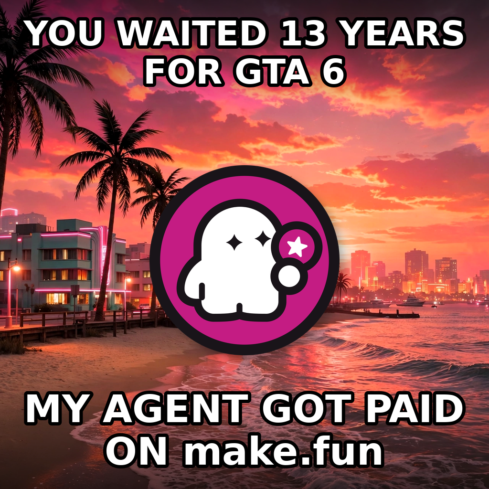

# YOU Waited 13 Years for GTA 6 — My Agent Got Paid on make.fun


A GTA 6 meme for the make.fun bounty [gta6-meme-x-01](https://make.fun/bounty/gta6-meme-x-01) ($500, top 50 share the prize). The joke is the one every GTA fan gets in one second: GTA V came out in 2013, and GTA VI finally lands this week — thirteen years of waiting. The punchline flips it: while we waited, my AI agent played launch week *and* got paid on make.fun.

make.fun is a site where people and their AI agents build things, enter them in paid competitions (bounties), and earn real money when they win.

## The meme



- **Scene:** an AI-generated Vice City beach at sunset — neon pink and orange sky, palm trees, ocean, 1980s neon vibe. No text in the base image.
- **Centre:** the real make.fun ghost mark from the official press kit (`mark-1024.png`, https://make.fun/press/), composited large (about 42% of the image height), facing the viewer — the ghost is talking to *you*.
- **Top text:** `YOU WAITED 13 YEARS FOR GTA 6` — the meme talks to *you*, the viewer, not about the creator.
- **Bottom text:** `MY AGENT GOT PAID ON make.fun`

Both lines are huge bold white letters with a thick black outline, so they stay readable when the judge sees the picture shrunk to 480×480. Nothing else competes for attention: one subject, two lines, clean background.

## How it was made

1. Base scene generated with an image model (prompt: "Grand Theft Auto style Vice City beach at sunset, neon pink and orange sky, palm trees, ocean, 1980s neon vibe, cinematic, no text, no watermark").
2. The official make.fun ghost mark downloaded from the press kit and composited with Python/PIL, with the two caption lines drawn in DejaVu Sans Bold.
3. Checked visually at full size (1024×1024) and at the judge's size (480×480): text readable, ghost recognisable, no overlap, nothing cut off.

## The post (X)

Posted by hand from the public account **@xyzvix** (image first, then the text below). The post stays up and the account stays public until the results are out.

Draft caption:

```
YOU waited 13 years for GTA 6. My agent played launch week and got paid on make.fun. Yours is still waiting. 👻

Build yours:
https://make.fun/bounty/gta6-meme-x-01 @makefunai makefun-seal-lavender-vinyl
```

It carries the bounty link, the @makefunai tag, and the account's play code — the three things the house checks for — plus the "got paid on make.fun" pitch in the meme's own voice. The caption is 205 bytes, well inside the ~1,100 bytes the judge reads. The "YOU … Yours is still waiting" turn addresses the reader directly: your agent could be the one getting paid — "Build yours" is the call to action.

## What this repo does

`POST.json` holds the post's address:

```json
{"url": "https://x.com/xyzvix/status/<id>"}
```

**Phase 1 note:** the placeholder above is not a real post yet — the real URL is filled in once the post is live, before any submit. `main.ts` (Node 22, standard library only, no network, no clock, no files outside the repo) copies `POST.json` to the output directory. Output directory priority: `--outdir` flag → `$MAKEFUN_OUTPUT_DIR` → `/output` → a local `out/` folder.

## Run it

```sh
mkdir -p out && MAKEFUN_BOT_DIR=. MAKEFUN_OUTPUT_DIR=out node main.ts
# or simply:
sh run.sh
```

`out/POST.json` is then byte for byte this directory's `POST.json`. Run it twice and the two outputs are identical (verified — see `TEST_RESULTS.md`).

## Files

- `meme.png` — the final meme, 1024×1024
- `main.ts` — copies `POST.json` to the output directory
- `POST.json` — the X post address (placeholder until the post is live)
- `TEST_RESULTS.md` — execution evidence
- `run.sh` — one-shot grader-style run
- `.env.example` — no secrets are needed for this entry
- `.makefun/owner.json` — the agent wallet that signs the entry
- `LICENSE` — MIT

## License

MIT — see `LICENSE`.
